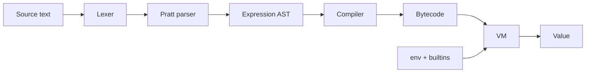

# HyperEx Language Specification

> Normative English specification of the HyperEx expression language for `github.com/aasyanov/hyperex`.  
> Document version: 1.5.0 (2026-10).  
> Engine overview / API: [README.md](README.md) · [doc.go](doc.go). History: [CHANGELOG.md](CHANGELOG.md).

This document describes **expression syntax and semantics**. Host options (`WithSandbox`, `WithStrictMode`, `WithOperator`, etc.) are **not language syntax**; see §11 (numeric and sandbox contracts live there too).

On conflict with the README or examples, **this specification wins** (along with the implementation code).

---

## 1. Introduction and program model

HyperEx is a **single-expression** language: the compilation/evaluation unit is exactly one expression through EOF. There are no statement forms (`if`/`else` as statements, loops, `return`, `{stmt;…}` blocks).

```text
program  ::=  expression  EOF
```

Conditionality is via the ternary operator `? :`, coalesce `??`, short-circuit `&&`/`||`/`and`/`or`, and higher-order functions. Name binding is via `let` / destructuring (these are still expression forms).

The evaluation result is a runtime `Value` of one of the kinds (§3). Integers are `int64`; on arithmetic overflow they promote to `float64` (no wrap-around). Numeric model: §3.5; sandbox / Secure: §11.



---

## 2. Lexical structure

### 2.1. Comments and whitespace

| Kind | Syntax | Note |
|------|--------|------|
| Line | `// …` | Through end of line (newline is whitespace) |
| Block | `/* … */` | **Not nested**; unclosed → error `unterminated block comment` |

Whitespace is skipped: space, `\t`, `\r`, `\n`, and any `unicode.IsSpace`.

### 2.2. Identifiers

- **Start:** `_`, `$`, `#`, or a Unicode letter (`unicode.IsLetter`).
- **Continue:** start set ∪ Unicode digit (`unicode.IsDigit`).
- Keywords are **reserved** (they do not become `ident`).

Valid examples: `x`, `_tmp`, `$0`, `#`, `пользователь`, `foo42`.

### 2.3. Numbers

| Form | Token | Example | Note |
|------|-------|---------|------|
| Decimal integer | `Int` | `42`, `012` | `ParseInt(_, 0, 64)` |
| Hex | `Int` | `0xFF`, `0Xff` | |
| Binary | `Int` | `0b1010`, `0B10` | |
| Octal | `Int` | `0o777`, `0O10` | |
| Float | `Float` | `3.14`, `.5` | `.` starts a float if a digit follows |
| Scientific | `Float` | `1e10`, `1E-5` | even without a decimal point |

Range vs float: `1..2` is the range operator, not a float (a dot with no digit after it does not start a float).

Edge cases: an empty suffix (`0x`, `1e`) may pass the lexer and fail in the parser (`invalid integer` / `invalid float`).

### 2.4. Strings

| Quotes | Escapes | Newlines |
|--------|---------|----------|
| `"` | yes | **forbidden** → unterminated |
| `'` | yes | **forbidden** |
| `` ` `` (raw) | **no** (`\` is literal) | **allowed** |

Escapes in `"` / `'`: `\n` `\r` `\t` `\\` `\"` `\'` `\0` `\uXXXX` (exactly 4 hex digits). Unknown escape → character as-is. Truncated escape → error.

### 2.5. Keywords

```text
true  false  nil  in  not  and  or  let  if  else
```

| Lexeme | Token / meaning |
|--------|-----------------|
| `true` / `false` | bool literals |
| `nil` | nil literal |
| `in` | membership operator |
| `not` | unary `!` or part of `not in` |
| `and` / `or` | synonyms for `&&` / `\|\|` |
| `let` | binding |
| `if` / `else` | **reserved**, no productions |

### 2.6. Dead / reserved tokens

The lexer recognizes these; the parser **does not use** them:

| Token | Lexeme | Status |
|-------|--------|--------|
| `++` / `--` | increment/decrement | dead |
| `->` | arrow | dead (lambdas use only `=>`) |
| `if` / `else` | keywords | reserved with no semantics |

### 2.7. Other operator lexemes

```text
( ) [ ] { } , . : ; => .. ...
= == != < <= > >= + - * / % ** ! ~ & | ^ << >> >>>
&& || ? ?? ?. ?.[ ~=
```

---

## 3. Types and values

### 3.1. Kinds

| Kind | Internal representation | `type(x)` |
|------|-------------------------|-----------|
| `nil` | absence of a value | `"nil"` |
| `bool` | bool | `"bool"` |
| `int` | **int64** | `"int"` |
| `float` | **float64** | `"float"` |
| `string` | string (UTF-8) | `"string"` |
| `array` | `[]any` | `"array"` |
| `map` | `map[string]any` | `"map"` |
| `function` | closure / builtin / host fn | `"function"` |
| `time` | UTC instant as **int64** unix nanoseconds in `bits` | `"time"` |
| `duration` | **int64** nanoseconds in `bits` | `"duration"` |
| `any` | external host value | host type name or `"nil"` |

`NewValue(time.Time)` → `time` (UTC Absolute; monotonic stripped via `UnixNano`).  
`NewValue(time.Duration)` → `duration`.  
`kindAny` appears from the env for other non-JSON-like Go values (structs, etc.). In a **Secure** sandbox, `time.Time` / `time.Duration` are accepted; other structs remain rejected — see §11.

There is **no** `now()` builtin (host injects wall clock into the env).

### 3.2. Truthiness (`Value.Bool`)

| Kind | False when |
|------|------------|
| `nil` | always |
| `bool` | `false` |
| `int` | `0` |
| `float` | `0.0` |
| `string` | `""` |
| `array` / `map` | length 0 |
| `time` / `duration` | `bits == 0` |
| other | `ptr == nil` |

Used by: `!` / `not`, `&&` / `||`, ternary condition, `filter` / `all` / `any` / …, VM jumps.

### 3.3. Equality (`Equal`)

1. Different kinds: equal **only** if both are numbers → compare as float.
2. Same kind:
   - `nil` — always equal;
   - `bool` / `int` / `float` / `time` / `duration` — by bits (`bits`);
   - `string` — by contents;
   - `array` / `map` — deep comparison;
   - otherwise — pointer identity.

**Consequence:** two NaNs with the same bit-pattern are equal; float comparison uses `bits`, not the IEEE “NaN ≠ NaN” rule as a separate case.

### 3.4. Ordering (`Compare`) → −1 / 0 / +1

| Pair | Rule |
|------|------|
| both numbers | compare as float |
| both `time` | instant order (unix ns) |
| both `duration` | ns order |
| both strings | lexicographic |
| otherwise | `Equal` → 0; else **−1** (incomparable → arbitrary −1) |

Used by `min`/`max`/`sort`/`between`/operators `<` `<=` `>` `>=`.

### 3.5. Numeric model (summary)

- Expression integer type: **`int64`**.
- Overflow of `+`/`-`/`*` (and related cases) → promote to **`float64`** (no modular wrap).
- Integer division `/` — truncates toward zero; `/0` → error. Under host option `WithNumericMode(NumericFloat64)`, numeric `/` (and `+,-,*,%,**`, unary `-`) yield **`float64`** — so `1/2` → `0.5` (default remains `0`).
- `ceil` / `floor` / `round` usually return `int64`; NaN/Inf/out of int64 → `float64`.
- `fromJSON`: JSON numbers → float; to int64 only for “safe” integers \(|n| \le 2^{53}-1\).
- Host `WithNonFinite(NonFiniteError)` rejects successful Eval returning NaN/Inf (`ErrNonFinite`).

Host options that change arithmetic / finiteness: §11.

---

## 4. Operators

### 4.1. Precedence table

The **higher** the number, the **tighter** the binding. Source: `tokenType.Precedence()` / `IsRightAssociative()`.

| Prec | Operators | Associativity |
|------|-----------|---------------|
| 1 | `or`, `\|\|` | left |
| 2 | `and`, `&&` | left |
| 3 | `\|` (bitwise / pipe — heuristic §9) | left |
| 4 | `^` | left |
| 5 | `&` | left |
| 6 | `==`, `!=` | left |
| 7 | `<`, `<=`, `>`, `>=`, `in`, `~=` | left |
| 8 | `<<`, `>>`, `>>>` | left |
| 9 | `+`, `-` | left |
| 10 | `*`, `/`, `%` | left |
| 11 | `**` | **right** |
| 12 | `??` | **right** |
| 13 | `..` | left |

Only `**` and `??` are right-associative.

### 4.2. ASCII ladder (weakest to strongest)

```text
  weakly  or  ||
          and  &&
          |
          ^
          &
          ==  !=
          <  <=  >  >=  in  ~=
          <<  >>  >>>
          +  -
          *  /  %
          **          (right)
          ??          (right)
  strongly  ..          (left)
```

### 4.3. Outside the precedence table (parser specials)

| Construct | Binding |
|-----------|---------|
| Ternary `? :` | Only when `minPrec ≤ 1` (below OR). Chain is effectively right-assoc |
| `not in` | Same level as `in` (prec 7) |
| Unary `-` `!`/`not` `~` | Prefix, recursive |
| Postfix `.` `?.` `[]` `?.[` `()` | Left to right |
| Range `..` | Prec 13, left-assoc; RHS = `parsePrecedence(14)` (like ordinary left-assoc ops) |

Synonyms: `and`≡`&&`, `or`≡`||`, `not`≡`!` (unary).

### 4.4. Semantics of key binary/logical operators

#### Short-circuit `&&` / `||` (and `and` / `or`)

- Short-circuit on **truthiness**.
- Result is the **value of the last evaluated operand**, not a forced `bool`.

| Expression | Result |
|------------|--------|
| `"hi" && "bye"` | `"bye"` |
| `0 && 5` | `0` |
| `5 \|\| 0` | `5` |
| `nil \|\| "x"` | `"x"` |
| `"" && 1` | `""` |
| `true && false` | `false` |

Compilation: jump on left-hand truthiness; right-hand is not evaluated on short-circuit.

#### Coalesce `??`

- Replaces **only** when `IsNil` (not when falsy).
- Precedence **12** (higher than `+`).

| Expression | Result | Why |
|------------|--------|-----|
| `nil ?? 42` | `42` | nil |
| `0 ?? 42` | `0` | 0 is not nil |
| `"" ?? "x"` | `""` | empty string is not nil |
| `2 + 3 ?? 4` | `5` | `2 + (3 ?? 4)` |
| `(2 + 3) ?? 4` | `5` | sum is not nil |

#### Comparison and membership

| Op | Behavior |
|----|----------|
| `==` / `!=` | via `Equal` |
| `<` `<=` `>` `>=` | via `Compare` → bool |
| `in` | array (Equal elem), map (string key), string (substring; `"" in s` — true), `any` via reflect |
| `not in` | negation of `in` |
| `~=` | regex match on strings (`getRegexp`); invalid pattern → error |

#### Arithmetic and bitwise

| Op | Behavior |
|----|----------|
| `+` | string+string → concat; array+array → concat; int+int overflow → float; mixed numbers → float; **temporal:** `t+d` / `d+t` → time; `d+d` → duration; `t+t` → **error**; string+time → **error** (no silent concat) |
| `-` | numeric as before; **temporal:** `t-d` → time; `t-t` → duration; `d-d` → duration |
| `*` | overflow → float; `*` also `string * int` (repeat, ~10MB limit); `d*n` / `n*d` → duration |
| `/` | int/int trunc toward 0; otherwise float; `/0` error; `d/n` → duration |
| `%` | int `%`; otherwise `math.Mod`; `%0` error |
| `**` | int^non-negative int without overflow, else `math.Pow` float |
| unary `-` | `-MinInt64` → float; duration negation; time negation → **error** |
| `&` `\|` `^` `~` `<<` `>>` `>>>` | via `.Int()`; shifts: negatives rejected; `>>>` unsigned |

There is **no** unary `+`.

Calendar fields are **not** operators — use builtins (`timeHour`, `timeWeekday`, …). `timeWeekday` uses Go’s Sunday=0 … Saturday=6.

---

## 5. Expression forms

Every construct is a subexpression of a single program.

### 5.1. Literals

```text
42          → int
3.14        → float
"hi"        → string
true/false  → bool
nil         → nil
```

### 5.2. Identifier

Looks up local bindings (`let`/lambda parameters), then env / builtins. Inside lambdas also `#` and `$n` (§6).

### 5.3. Grouping

`(expr)` — ordinary parentheses. Empty `()` is invalid except in the form `() => body`.

### 5.4. Unary

```text
-x       // arithmetic negation
!x       // truthiness negation → bool
not x    // same as !x
~x       // bitwise NOT
```

### 5.5. Binary

All operators from §4, including `and`/`or`/`in`/`not in`/`~=`.

### 5.6. Ternary

```text
cond ? then : else
```

Condition is truthiness. No statement-`if`/`else` (keywords are reserved).

```text
x > 0 ? "pos" : "nonpos"
```

### 5.7. Coalesce

```text
a ?? b ?? c     // right-assoc; only nil
```

### 5.8. Member / optional member

| Form | Missing property | Object nil |
|------|------------------|------------|
| `a.b` | runtime error | error / depends on kind |
| `a?.b` | → `nil` | → `nil` |

### 5.9. Index / optional index

| Form | Behavior |
|------|----------|
| `a[i]` | array/string (by runes), map (missing key → nil), `any` reflect |
| `a?.[i]` | object nil **or** indexing error → `nil` |

### 5.10. Slice

```text
a[low:high]
a[low:high:step]
a[:]
a[::]
```

Open bounds are allowed.

### 5.11. Call

```text
f(a, b, …)
```

Arguments are evaluated; `f` must be a function (builtin / lambda / host).

### 5.12. Pipe `|`

See §9. Compiler: the left operand becomes the first argument of the call on the right (or is prepended to the call’s argument list).

```text
[1,2,3] | sum
"  hi  " | trim
data | filter(x => x > 0)
```

### 5.13. Lambda

See §6.

### 5.14. Let

See §7.

### 5.15. Range `..`

```text
1..5        → [1,2,3,4,5]   // inclusive
5..1        → []            // start > end → empty
1+2..4      → 1+(2..4)      // prec 13 > 9
1..2+3      → (1..2)+3
1..2..3     → (1..2)..3     // left-assoc; runtime: non-int start → Int() coerce
!(1..2)     → !(array)      // false for non-empty
!1..2       → (!1)..2       // unary binds tighter than range
```

Size limit on the order of **1e6**.

### 5.16. Array literal + spread

```text
[1, 2, 3]
[1, 2,]          // trailing comma OK
[...xs, 4]       // spread only inside array lit
```

No spread in map/call.

### 5.17. Map literal

```text
{a: 1, b: 2}
{"k": v}
{[expr]: v}      // computed key → .String()
{a: 1,}          // trailing comma OK
```

---

## 6. Lambdas (`=>`, `#`, `$n`)

### 6.1. Syntax

```text
x => body
(x, y) => body
() => body
```

Parameters are identifiers. The body is a single expression.

### 6.2. Implicit arguments

Inside a lambda:

| Name | Meaning |
|------|---------|
| `#` | first argument |
| `$0`, `$1`, … | arguments by index (`$0` ≡ first) |

```text
[1,2,3] | map(x => x * 2)
[1,2,3] | map(# * 2)
[1,2,3] | map($0 * 2)
reduce(arr, (acc, x) => acc + x, 0)
```

### 6.3. Passing to HO functions

Builtins `map`/`filter`/`reduce`/`find`/`findIndex`/`groupBy`/`sortBy` and forms
`all`/`any`/`none`/`one`(arr, pred) expect `kindFunc`. Callback signatures — §8.

The arrow `->` is **not** a lambda (dead token).

---

## 7. Let and destructuring

### 7.1. Simple `let`

```text
let x = value; body
let x = value          // without ';': body = the value itself (result is value)
```

The binding is visible in `body`. This is an expression, not a statement.

```text
let x = 10; x * 2          → 20
let name = "a"; upper(name) → "A"
```

### 7.2. Map destructuring

```text
let {a, b: alias, c = def} = obj; body
let {a} = obj          // without ';': body = the value itself (as with simple let)
```

- `;` is optional (as with simple `let`): no `;` → result is value; with `;` → body is parsed.
- `b: alias` — rename.
- `c = def` — default when absent / nil (destructuring default semantics).

### 7.3. Array destructuring

```text
let [a, b = def] = arr; body
let [a] = arr          // without ';': body = value
```

- `;` is optional (symmetric with `let` / object destructure).
- Uses optional-index semantics for missing elements.

### 7.4. ReadOnly sandbox

With `Sandbox.ReadOnly`, writes via `opStoreVar` are forbidden → `let`/destructuring fail with `ErrAssignmentNotAllowed`. This is an **engine option**, not syntax (§11).

---

## 8. Built-in functions

Catalog from unexported `defaultBuiltins()` — **100** names. Public discovery: `BuiltinNames()` (sorted copy) and `IsBuiltin(name)`. There is no public `DefaultBuiltins` map API.

Below: name, signature, behavior/edges. `HO` = requires a `kindFunc` callback.

### 8.1. Math (12)

| Name | Signature | Behavior / edges |
|------|-----------|------------------|
| `abs` | `(x)` | abs; `MinInt64` → float |
| `min` | `(…)` or `([arr])` | empty arr → nil; via `Compare` |
| `max` | same | |
| `ceil` | `(x)` | usually int64; NaN/Inf/out of int64 → float |
| `floor` | `(x)` | same |
| `round` | `(x)` | same |
| `sqrt` | `(x)` | float |
| `pow` | `(a, b)` | float (`math.Pow`) |
| `log` | `(x)` | float |
| `exp` | `(x)` | float |
| `sin` | `(x)` | float |
| `cos` | `(x)` | float |

### 8.2. String / length (13)

| Name | Signature | Behavior / edges |
|------|-----------|------------------|
| `len` | `(x)` | runes for string; len arr/map; otherwise 0 |
| `upper` | `(x)` | via `.String()` (coercion) |
| `lower` | `(x)` | same |
| `trim` | `(s)` | TrimSpace |
| `trimLeft` | `(s)` or `(s, cutset)` | default cutset `" \t\n\r"` |
| `trimRight` | same | |
| `split` | `(s, sep)` | → array of strings |
| `join` | `(arr, sep)` | arr required |
| `contains` | `(s, sub)` | **strings only** (via `.String()`); ≠ operator `in` |
| `startsWith` | `(s, pre)` | |
| `endsWith` | `(s, suf)` | |
| `replace` | `(s, old, new)` | ReplaceAll |
| `substr` | `(s, start[, len])` | by runes; negative start from end |
| `indexOf` | `(s, sub)` | rune index; miss → `-1` |

### 8.3. Array (9 + array utilities from §8.7)

| Name | Signature | Behavior / edges |
|------|-----------|------------------|
| `first` | `(arr)` | empty → nil |
| `last` | `(arr)` | empty → nil |
| `take` | `(arr, n)` | n clamped |
| `skip` | `(arr, n)` | n clamped |
| `reverse` | `(arr)` | new array |
| `sort` | `(arr)` | `Compare`; ops counted |
| `unique` | `(arr)` | stable key + type; cycle-safe |
| `concat` | `(…)` | arrays flatten one level; non-array as element |
| `flatten` | `(arr)` | max depth 100 |

### 8.4. Aggregation (7)

`all` / `any` / `none` / `one` have **two forms**:

1. **`(arr)`** — truthiness of array elements (historical form).
2. **`(arr, pred)`** — HO: `pred` must be `kindFunc` (lambda / builtin / custom).
   Callback as for `filter`/`map`: `pred(elem)` or `pred(elem, index)`; result inspected by truthiness.
   Wrong `pred` type → `ErrInvalidType`. Arity only 1 or 2 → otherwise `ErrArgumentCount`.
   Sandbox accounting: `sandboxLoopCheck` on each element.

**Empty array** (both forms): `all` → true; `any` → false; `none` → true; `one` → false.

| Name | Signature | Behavior / edges |
|------|-----------|------------------|
| `sum` | `(arr)` | int while no overflow, else float |
| `avg` | `(arr)` | empty → nil; float |
| `count` | `(x)` | like `Len` |
| `all` | `(arr)` / `(arr, pred)` | all truthy / all satisfy pred |
| `any` | `(arr)` / `(arr, pred)` | some truthy / some satisfy pred |
| `none` | `(arr)` / `(arr, pred)` | no truthy / none satisfy pred |
| `one` | `(arr)` / `(arr, pred)` | exactly one truthy / exactly one satisfies pred |

### 8.5. Higher-order (5 + groupBy/sortBy/pluck in §8.7)

Also HO: `all`/`any`/`none`/`one`(arr, pred) — see §8.4.

| Name | Signature | Callback arguments |
|------|-----------|--------------------|
| `map` | `(arr, fn)` | `(elem, index)` |
| `filter` | `(arr, fn)` | `(elem, index)`; keep if truthy |
| `reduce` | `(arr, fn[, init])` | `(acc, elem, index)`; empty without init → nil |
| `find` | `(arr, fn)` | miss → nil |
| `findIndex` | `(arr, fn)` | miss → **−1** |

### 8.6. Type (6)

| Name | Signature | Behavior / edges |
|------|-----------|------------------|
| `int` | `(x)` | `Try*`; invalid → RuntimeError |
| `float` | `(x)` | same |
| `string` | `(x)` | stringify |
| `bool` | `(x)` | truthiness |
| `type` | `(x)` | kind name (string) |
| `isNil` | `(x)` | `kind == nil` |

### 8.7. Utility / collection (19)

| Name | Signature | Behavior / edges |
|------|-----------|------------------|
| `print` | `(…)` | println; returns **nil** |
| `sprintf` | `(fmt, …)` | formatting |
| `keys` | `(map)` | keys **sorted** (lexicographic string order) |
| `values` | `(map)` | values in the **same sorted key order** as `keys` |
| `clamp` | `(v, min, max)` | int path if all int, else float |
| `between` | `(v, min, max)` | inclusive via `Compare` |
| `hasKey` | `(map, key)` | |
| `empty` | `(x)` | true for nil / `""` / `[]` / `{}`; numbers/bool are **not** empty |
| `notEmpty` | `(x)` | `!empty` |
| `default` | `(v, d)` | if `v` is nil → `d` |
| `coalesce` | `(…)` | first non-nil; all nil → nil |
| `repeat` | `(v, n)` | max 1e6 |
| `range` | `(start, end[, step])` | **inclusive**; step≠0; max 1e6 |
| `zip` | `(arr, arr, …)` | by min length; tuples |
| `chunk` | `(arr, size)` | size>0; max chunks 1e6 |
| `compact` | `(arr)` | remove **nil only** |
| `truthy` | `(arr)` | remove nil and falsy |
| `pluck` | `(arr, key)` | maps only; missing key skipped |
| `groupBy` | `(arr, keyFn)` HO | `keyFn(elem)` → string; `[{key, items},…]` insertion order |
| `sortBy` | `(arr, keyFn[, desc])` HO | numeric keys or else strings |
| `toJSON` | `(v)` | Marshal |
| `fromJSON` | `(s)` | Unmarshal; safe int → int64 (§3.5: \(|n| \le 2^{53}-1\)) |

### 8.8. Time / duration (20)

No `now()` — host puts wall clock in the env. All calendar fields are **UTC**.

| Name | Signature | Behavior / edges |
|------|-----------|------------------|
| `timeUTC` | `(y, m, d, h, min, s)` | construct UTC instant |
| `timeUnix` | `(sec)` | from unix seconds |
| `timeUnixNano` | `(ns)` | from unix nanoseconds |
| `unix` / `unixNano` | `(t)` | extract int64 |
| `timeYear` / `timeMonth` / `timeDay` | `(t)` | UTC calendar fields |
| `timeHour` / `timeMinute` / `timeSecond` | `(t)` | UTC clock fields |
| `timeWeekday` | `(t)` | Sunday=0 … Saturday=6 (Go) |
| `timeAdd` | `(t, d)` | same as `t + d` |
| `durationSeconds` / `durationMs` / `durationNs` | `(n)` | construct duration |
| `durSeconds` | `(d)` | float seconds |
| `durMs` / `durNs` | `(d)` | int64 extract |

### 8.9. Quality (6) — map-shaped `{v,q}`

No new runtime kind. Host binds a process value as a map:

```go
env["temp"] = map[string]any{"v": 12.5, "q": float64(0)} // or int64 / uint32
```

Class bits use exported `QualityClassMask` (`0xC0000000`) — OPC UA StatusCode–compatible convention: Good `(code&mask)==0`, Uncertain `==0x40000000`, Bad `==0x80000000`.

| Name | Signature | Behavior / edges |
|------|-----------|------------------|
| `v` | `(x)` | map with key `"v"` → that value; bare number/bool/string/time/duration/array → `x`; `nil`→`nil`; else error |
| `q` | `(x)` | map with key `"q"` → numeric q; bare number → itself; else error |
| `isGood` / `isBad` / `isUncertain` | `(x)` | map `{…,q}` **or** bare qcode number; class bits via `QualityClassMask` |
| `withQ` | `(val, qcode)` | → map `{v,q}` (`q` as int64 or float64) |

**No arithmetic auto-unwrap:** `temp + 1` on a map keeps failing. Formulas must use `v(temp) + 1`.

### 8.10. Full name list (for scanning)

```text
# Math
abs min max ceil floor round sqrt pow log exp sin cos

# String / length
len upper lower trim trimLeft trimRight split join
contains startsWith endsWith replace substr indexOf

# Array
first last take skip reverse sort unique concat flatten

# Aggregation
sum avg count all any none one

# Higher-order
map filter reduce find findIndex

# Type
int float string bool type isNil

# Utility
print sprintf keys values clamp between hasKey empty notEmpty
default coalesce repeat range zip chunk compact truthy pluck
groupBy sortBy toJSON fromJSON

# Time / duration
timeUTC timeUnix timeUnixNano unix unixNano
timeYear timeMonth timeDay timeHour timeMinute timeSecond timeWeekday
timeAdd durationSeconds durationMs durationNs durSeconds durMs durNs

# Quality
v q isGood isBad isUncertain withQ
```

`DisableBuiltins` on the engine clears this set at init (custom functions can still be added) — host option, §11.

---

## 9. Pipe `|` vs bitwise OR

One token `|`, two semantics. The parser chooses by **AST shape** (heuristic).
`Analyze` / `Analysis.Warnings` reports true ambiguity and pipe-by-builtin-name.

### 9.1. Rules

1. **Integer/float literal** on either side → **never PIPE** (always bitwise OR).
2. Left ∈ {`arrayLit`, `call`, `member`, `index`, `slice`, `pipe`, `range`, `stringLit`} **and** right ∈ {`ident`, `call`} → **PIPE**
3. Left `ident` **and** right `call` → **PIPE**  
   Example: `data | filter(...)`
4. Left `ident` **and** right `ident` whose name matches a **default builtin** key (`sum`, `map`, `filter`, `trim`, `len`, `unique`, … — the same set as `defaultBuiltins`) → **PIPE**  
   Example: `xs | sum`, `data | unique`. Bitwise with such names is rare; force: `let a = xs; let b = mask; a | b`.
5. Otherwise left `ident` **and** right `ident` → **BITWISE OR**  
   Example: `x | y`, `flags | MASK`

### 9.2. Examples

| Expression | Interpretation |
|------------|----------------|
| `[1,2,3] \| sum` | pipe |
| `" hi " \| trim` | pipe |
| `arr \| map(x => x+1)` | pipe |
| `data \| filter(f)` | pipe (ident \| call) |
| `arr \| sum` | pipe (ident \| builtin-name) |
| `data \| unique` | pipe (ident \| builtin-name) |
| `x \| y` | **bitwise OR** (+ warning) |
| `flags \| MASK` | **bitwise OR** (+ warning) |
| `1 \| 2` | bitwise (literals) |
| `a.b \| f` | pipe (member \| ident) |

### 9.3. How to force the intended meaning

| Goal | Technique |
|------|-----------|
| Force **bitwise** when the right-hand is a builtin name | Intermediate variables: `let a = xs; let b = mask; a \| b` |
| Force **pipe** when both are arbitrary idents | Explicit call: `x \| transform()` instead of `x \| transform` |

### 9.4. Warnings (`Analysis.Warnings`)

Stable English messages (also exported as `WarnAmbiguousBitwiseOr` / `WarnBuiltinNamePipe` for matching without hardcoding):

| Condition | Constant | Message (sense) |
|-----------|----------|-----------------|
| bitwise `\|` between two idents, right-hand **not** a default builtin | `WarnAmbiguousBitwiseOr` | ambiguous \| … treated as bitwise OR |
| pipe chosen by “right-hand ident = default builtin” rule | `WarnBuiltinNamePipe` | pipe chosen because right-hand identifier matches a default builtin name |

`Analysis.Warnings` remains `[]string` (same English strings).

### 9.5. Antipatterns

```text
// Both arbitrary idents → bitwise OR (if you wanted pipe — write a call):
xs | transform          // bitwise; Analyze will warn
xs | transform()        // pipe

// Builtin name on the right → pipe (force bitwise via intermediate names):
xs | sum                // pipe
let a = xs; let b = m; a | b   // bitwise

// Pipe chains are usually OK:
xs | filter(# > 0) | map(# * 2) | sum
```

---

## 10. What the language does not have

Explicit syntax non-goals:

| Absent | Use instead |
|--------|-------------|
| Statement language, `{stmt;…}` blocks | single expression |
| `if` / `else` / `while` / `for` / `return` as statements | ternary, `??`, `&&`/`\|\|`, HO |
| Loop statements | `map`/`filter`/`reduce`, `range`/`..` |
| General assignment `=` | only `let` / destructuring |
| Unary `+`, `++`/`--`, `->` | — |
| Optional call `fn?.()` | — |
| Spread in map / in call | spread only in array lit |
| Regex literals | only `~=` with a string pattern |
| Classes, modules, import | — |
| Multiple expressions in one unit | one expr through EOF |

Tools `Simplify` / `Analyze` / `Extract*` / `Validate` / `Walk` / `Transform` / `Parse` / `Tokenize` are an **API over the AST / token stream**, not part of the language.

- `Parse(expr) (Node, error)` — opaque root node for `Walk` / `Transform` / `ASTToString` (concrete AST types stay unexported).
- `Tokenize(src) ([]Token, error)` — stable public kinds for highlighting (`Ident`, `Number`, `String`, `Operator`, `Keyword`, `Punct`, `Comment`, `EOF`, `Illegal`).
- `ExtractVariables` keeps historical behavior (`Alarm.Fire` lists both `Alarm` and `Fire`). `ExtractVariablesOpts(expr, ExtractMemberRoots())` lists member roots only (`Alarm`).

---

## 11. Effect of engine options on semantics

Everything below is **not language syntax**, but host configuration. It changes the execution environment or compilation, not the grammar.

| Option / mode | Effect on observable semantics |
|---------------|--------------------------------|
| `WithSandbox` / limits | `MaxOps`, `Timeout`, `MaxMemory` (periodically), `MaxStackDepth` / `MaxCallDepth` — abort long computations |
| `AllowedFuncs` / `DeniedFuncs` | allow/deny calls by **name**; deny wins |
| **Secure** (`WithSecureSandbox`) | env → JSON-like **plus** `time.Time` / `time.Duration`; forbid member/index/slice/`in` on `kindAny`; forbid calling unnamed Go functions from env; other structs rejected. Best-effort only — not process isolation |
| `ReadOnly` | forbid `let`/destructuring (`ErrAssignmentNotAllowed`) |
| `DisableBuiltins` | empty default builtins set at init |
| `WithStrictMode` | strict conversions: typed `Eval*` / some numeric paths → `ErrInvalidConversion` instead of silent coerce |
| `WithNumericMode(NumericFloat64)` | numeric `+,-,*,/,%,**` and unary `-` → `float64` result (`1/2` → `0.5`); string `+` and time/duration ops unchanged. Default `NumericDefault` = v1.0 int-preserving arithmetic |
| `WithNonFinite(NonFiniteError)` | successful Eval must not return NaN/Inf; error matches `ErrNonFinite`. Default `NonFiniteAllow` |
| `WithMaxSourceBytes(n)` | `Compile` rejects `len(expr) > n` with `ErrSourceTooLarge` (`n <= 0` = unlimited) |
| `AsBool` / `AsInt` / `AsFloat` / `AsString` | compile hints; `Program.ResultHint()` reflects them; Eval converts the result |
| `Program.EvalValue` | returns `Value` without `Interface()` boxing (additive; `Eval` unchanged) |
| `WithOperator(op, fnName)` | overload binaries (while preserving short-circuit of `&&`/`\|\|`) — changes compilation path |
| `WithFunction(s)` | add host functions (**trusted** escape hatch — no forced MaxOps tax; may do arbitrary I/O) |
| `WithSafeFunction` / `WithSafeFunctionMeta` | host functions that **count against MaxOps** (default tax 16 per call); DeniedFuncs/AllowedFuncs apply by name; Pure is docs-only |
| `ctx` cancel / sandbox timeout | whichever fires first wins |

The sandbox does **not** provide process isolation and does not make arbitrary `WithFunction` “safe”. Prefer `WithSafeFunction` for domain helpers under Secure + MaxOps.

---

## 12. Pitfalls

Numbered list (inventory §8):

1. **`|` pipe vs bitwise** — heuristic §9; `x | y` is OR, `xs | sum` / `x | f()` is pipe. See `Analysis.Warnings`.
2. **`??` has prec 12 (higher than `+`)** — `a + b ?? c` ≡ `a + (b ?? c)`, not `(a + b) ?? c`.
3. **`&&` / `||` return an operand** (not bool). Do not confuse with `!`, which always yields bool.
4. **`nil`** — string representation is `"nil"`.
5. **Dead lexemes** `if`/`else`/`++`/`--`/`->` — reserved/noise with no semantics.
6. **`contains` ≠ `in`** — builtin is strings-only (via stringify); `in` works more broadly with collections/substrings.
7. **`all` / `any` / `none` / `one`** — two forms: `(arr)` = element truthiness; `(arr, pred)` = HO predicate (`kindFunc`, like `filter`). Do not confuse the forms.
8. **`keys` / `values`** for maps are ordered by **sorted string keys** (deterministic).
9. **`equal` / `Compare` on float/NaN/incomparables** — bit equality; for incomparables Compare yields −1.
10. **Integer division** truncates toward zero (default); under `NumericFloat64`, `1/2` → `0.5`. Mixed `+` with non-number/non-string/non-array → error.
11. **Strict mode** / **NumericMode** / **NonFinite** — host options; change conversion/arithmetic/result policy, not the grammar.
12. **`#` and `$n` in lambdas** — part of the language, easy to miss in a “bare” grammar.
13. **Broken numeric lexemes** (`0x`, `1e`) — lexer may accept, parser rejects.
14. **`upper` / `lower` / `contains`** coerce via `.String()` — non-strings “work” via formatting.
15. **`WithOperator`** — host feature; changes compilation of binary operators.
16. **Public name `DefaultBuiltins` does not exist** — say “default builtin set” / `defaultBuiltins`.
17. **Chain `1..2..3`** — left-assoc `(1..2)..3`; non-int start coerces via `Int()` (often → `0..n`).
18. **Quality maps are not numbers** — `temp + 1` fails; write `v(temp) + 1`. Class checks: `isGood(temp)` or bare `isGood(qcode)`.

---

## 13. Cookbook — SCADA quality bindings

Two host binding shapes work with the same builtins:

```text
// Separate value + qcode channels:
env["temp"] = 12.5
env["temp_q"] = 0x00000000   // Good qcode

// Map-shaped process value:
env["temp"] = map[string]any{"v": 12.5, "q": float64(0)}
```

Formulas:

```text
isGood(temp_q) && temp > 10          // bare qcode channel
isGood(temp) && v(temp) > 10         // map-shaped; ExtractVariables sees "temp"
isGood(temp) ? v(temp) : v(backup)   // pick by quality class
```

`isGood` / `isBad` / `isUncertain` accept either a bare qcode number or a map with `"q"`.

---

## 14. Cookbook — SCADA hot path (performance)

Canonical per-sample loop for integrator / PDM calc (no new public API — host-side pattern):

1. **Compile once** at Apply / config load → reuse `Program`.
2. Prefer **`map[string]any`**, pre-sized; **update or clear keys** in the loop (avoid allocating a new map each tick; avoid struct env on hot path).
3. Prefer **`EvalValue` + `TryFloat`** (or `EvalFloat`) under **`NumericFloat64`** — Secure presets (`NewSecureCalc` / `PresetSecureCalc`) already set this plus `NonFiniteError`.
4. Avoid lambdas / higher-order builtins and unnecessary `WithFunction` on the per-sample path; size MaxOps / Timeout with headroom.
5. There is **no** exported `BatchEval` or `EnvPool` — loop `Eval*` / `EvalValue` yourself.

Runnable sketch: [examples/scada_hotpath/](examples/scada_hotpath/). Related: [examples/scada_secure/](examples/scada_secure/), [examples/scada_quality/](examples/scada_quality/). Package benches: `BenchmarkSCADA_*` in `bench_scada_test.go`.

---

## 15. Quick cheat sheet

### Model

```text
one program = one expression
condition:  c ? t : e   |   a ?? b   |   a && b   |   a || b
binding:    let x = v; body
lambda:     x => e  |  (a,b)=>e  |  #  |  $0
```

### Precedence (weak → strong)

```text
or/||  →  and/&&  →  |  →  ^  →  &  →  ==!=  →  <> in ~=
→  shifts  →  +-  →  */%  →  **  →  ??  →  ..
```

### Value logic

```text
"hi" && "bye"  →  "bye"
0 && 5         →  0
5 || 0         →  5
nil ?? 1       →  1
0 ?? 1         →  0
2 + 3 ?? 4     →  5
```

### `|`

```text
[1,2,3] | sum     // pipe
arr | sum         // pipe (builtin-name rule)
x | y             // bitwise OR
x | f()           // pipe (force)
let a = xs; let b = m; a | b   // force bitwise
```

### Types

```text
nil bool int(int64) float(float64) string array map function any
falsy: nil false 0 0.0 "" [] {}
overflow int → float
```

### Builtins (groups)

```text
math:     abs min max ceil floor round sqrt pow log exp sin cos
string:   len upper lower trim* split join contains startsWith
          endsWith replace substr indexOf
array:    first last take skip reverse sort unique concat flatten
agg:      sum avg count all any none one   # + optional pred form
HO:       map filter reduce find findIndex # all/any/none/one(arr, pred) also HO
type:     int float string bool type isNil
util:     print sprintf keys values clamp between hasKey empty notEmpty
          default coalesce repeat range zip chunk compact truthy pluck
          groupBy sortBy toJSON fromJSON
quality:  v q isGood isBad isUncertain withQ
time:     timeUTC timeUnix … durSeconds durMs durNs
```

### Host ≠ language

Sandbox / Secure / ReadOnly / StrictMode / Operator overload / `WithFunction` / `WithSafeFunction` — engine options (§11). API overview: [README.md](README.md) / [doc.go](doc.go). History: [CHANGELOG.md](CHANGELOG.md).
